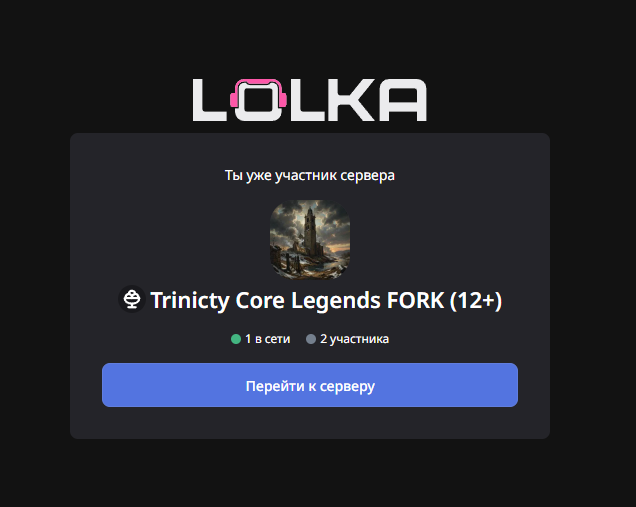

# TrinityCore · `new-content`

[](COPYING)


> Рабочая ветка на базе TrinityCore `master`. Цель — добавлять только **проверенный Blizzlike-контент** для retail-клиента `12.1.5.70077`, не ломая то, что уже работает в апстриме.

---

## Содержание

- [Быстрые ссылки](#быстрые-ссылки)
- [О проекте](#о-проекте)
- [Принципы разработки](#принципы-разработки)
- [Что уже добавлено](#что-уже-добавлено)
- [Требования](#требования)
- [Сборка](#сборка)
- [База данных](#база-данных)
- [Правила SQL](#правила-sql)
- [Локализация](#локализация)
- [Как добавить контент](#как-добавить-контент)
- [Проверка перед коммитом](#проверка-перед-коммитом)
- [Известные ограничения](#известные-ограничения)
- [Источники и ссылки](#источники-и-ссылки)
- [Лицензия](#лицензия)

---

## Быстрые ссылки

- **[Чат проекта в Lolka (аналог Discord)](https://lolka.gg/8snOouNIX)** — обсуждение сборки, баг-репорты и координация работ.
- [Официальный сайт TrinityCore](https://www.trinitycore.org)
- [Wiki TrinityCore](https://www.trinitycore.info)
- [Issue tracker TrinityCore](https://github.com/TrinityCore/TrinityCore/issues)
- [Исходный репозиторий TrinityCore](https://github.com/TrinityCore/TrinityCore)

Приглашение в чат:



---

## О проекте

Это не официальный дистрибутив TrinityCore, а локальная ветка `new-content`, в которую выборочно переносятся недостающие игровые механики, квесты, спеллы и данные. Основной упор делается на материал, который можно подтвердить клиентскими DB2 и исходным кодом апстрима, а не на «кастомные» фичи.

Источники, которые разбираются и фильтруются:

- официальный [TrinityCore `master`](https://github.com/TrinityCore/TrinityCore) и его открытые issue/PR;
- [Dragonflight_Dekk-Core](https://github.com/KamiliaBlow/Dragonflight_Dekk-Core), каталоги `DekkCore/Scenarios` и `DekkCore/Legion`;
- [aquadeus/TrinityCore](https://github.com/aquadeus/TrinityCore) — отдельные проверенные ветки с исправлениями квестов;
- локальный репарс клиентских **DB2 → CSV** для сборки `12.1.5.70077`.

Всё, что нельзя подтвердить клиентом или кодом, в ветку не попадает.

---

## Принципы разработки

1. **Не ломать работающее.** Приоритет — совместимость с текущим `master`; правки в общие файлы скриптов сводятся к минимуму.
2. **Только `Custom` + SQL.** Новый C++-код живёт в `src/server/scripts/Custom/**` и подключается через `custom_script_loader.cpp`. Файлы `src/server/scripts/**` из `master` и `src/server/game/**` не редактируются.
3. **Никаких ручных правок `ScriptLoader.cpp`.** Он генерируется системой сборки.
4. **Данные из клиента.** ID спеллов, квестов, NPC, сценариев и констант сверяются с DB2 `12.1.5.70077`; выдуманные значения запрещены.
5. **Idempotent SQL.** Каждый файл можно применять повторно: `DELETE` только своих строк, затем `INSERT`.
6. **Локализация.** Новые строки обязаны иметь базу `enUS` и русский перевод; перед созданием новых строк проверяются `BroadcastTextId` и уже существующие `*_locale`.
7. **Локальные коммиты.** Изменения фиксируются в `new-content`; push выполняется только после явного согласия.

---

## Что уже добавлено

| Дата | Файл(ы) | Что исправлено |
|---|---|---|
| 2026-11-28 | `sql/updates/hotfixes/master/2026_11_28_62_hotfixes_scenarios.sql`, `sql/updates/world/master/2026_11_28_62_world_scenarios.sql` | Зависимости сценария `566`, шаги `1053/1054/1055`, сценарии `569/570/571`, criteria/criteria-tree, `modifier_tree 12711`, `world_state_expression 5497`. |
| 2026-11-28 | `src/server/scripts/Custom/Pandaria/spell_monkey_wisdom_text.cpp`, `…_monkey_wisdom_text.sql` | Современный `SpellScript` для `104126`, привязка через `spell_script_names`, без правки апстрим-файлов. |
| 2026-11-28 | `…_world_gilneas_chapter_1.sql` | Гилнеас, Glaive Square до Lockdown (issue `#32109`): корректный `entry 34851` + условие по `StringId`, уборка устаревших per-guid smart scripts. |
| 2026-11-28 | `…_world_earthen_intro_chain.sql` | Вводная цепочка Earthen: `79200 → 83328`, `83328 ← 79200`, проверено на живой БД. |
| 2026-11-28 | `…_world_prayer_circle_proc.sql` | «Молитвенный круг» (`321377`): восстановлено ограничение проков на Holy Word: Sanctify по данным `Talent.db2` и `SpellClassOptions.db2`. |
| 2026-11-28 | `src/server/scripts/Custom/DunMorogh/npc_ultrasafe_personnel_launcher.cpp`, `…_quest_25839_launcher.sql` | Квест `25839` «The Ultrasafe Personnel Launcher»: spellclick `77424` вместо `59099`, AI катапульты в `Custom`. |
| 2026-11-28 | `src/server/scripts/BrokenIsles/WorldBosses/`, `…_world_legion_world_bosses.sql`, `…_world_legion_world_boss_spawns.sql` | Мировые боссы Расколотых островов: 7 скриптов из `DekkCore/Legion/WorldBosses`, привязки 14 спеллов и 9 `ScriptName`, спавны на `map 1220` с координатами из клиентских DB2/`.map`. |
| 2026-11-28 | `src/server/scripts/BrokenIsles/WorldBosses/boss_ana_mouz.cpp`, `boss_nazak_the_fiend.cpp`, `boss_withered_jim.cpp`, `…_world_legion_remaining_bosses.sql` | Ещё 3 мировых босса Legion после проверки зависимостей: привязки 2 спеллов и 3 `ScriptName`, спавн Withered J'im по точной строке DekkCore. У Na'zak не привязан no-op аура-скрипт, у Withered J'im удалён не-Blizzlike античит. |
| 2026-11-28 | `src/server/scripts/BrokenIsles/WorldBosses/boss_levantus.cpp`, `boss_nithogg.cpp`, `boss_sharthos.cpp`, `boss_the_soultakers.cpp`, `…_world_legion_four_remaining_bosses.sql` | Последние 4 мировых босса перенесены с локальной адаптацией без правок ядра: 4 spell-биндинга Nithogg, 8 `ScriptName` и 8 спавнов на `map 1220`. Nithogg — по точной строке DekkCore, остальные координаты — из полной БД [WarAxe_Legion](https://github.com/boom8866/WarAxe_Legion) 7.3.5. Добавлены также спавны Ana-Mouz и Na'zak. |
| 2026-11-28 | `sql/updates/world/master/2026_11_28_62_world_legion_world_boss_content.sql` | Стоковый контент для 14 боссов и помощников: 132 строки лута и `LootID = Entry`, 13 реплик с RU-локализацией из `broadcast_text_locale`, 84 записи `creature_template_spell`, aura `223355` для `112128`. Исправлена опечатка `spell_flotsam_getsam_damage`: `220377` → `220367`. Не перенесены кастомные AT и `bytes1` Nithogg (`STEALTHED`). |

В работе: выборочный перенос подтверждённого контента из `DekkCore/Scenarios` и `DekkCore/Legion`. Все 14 мировых боссов Legion теперь имеют скрипты, привязки, спавны, лут, реплики и закастовые спеллы. Биндинги AT `7053`/`7411` не добавляются: эти AT отсутствуют в клиентском `AreaTrigger.csv` и в живой БД; в WarAxe они есть, но только в устаревшем формате `areatrigger_actions`, который несовместим с текущей схемой. `BroadcastTextId` для реплик есть в `hotfixes.broadcast_text`, но отсутствуют в серверном `BroadcastText.db2` и `hotfix_blob`, поэтому BT обнулены, а RU-текст взят из готовой локализации без дублей. Стартовые NPC рас и классов проверены: явных пропусков нет, именованные тренеры из TDB 7.3.5 в актуальном клиенте удалены.

---

## Требования

- **OS:** Windows 10/11 x64 (основная платформа проекта) или Linux/macOS через штатные инструкции TrinityCore.
- **Компилятор:** Visual Studio 2022 Build Tools (English/ Russian pack не обязателен), C++17.
- **Сборка:** CMake ≥ 3.20, Ninja.
- **Зависимости:** Boost, OpenSSL, MySQL 8.4 client library. На текущей машине используются `C:\libs\boost` и `C:\libs\openssl`.
- **Сервер БД:** MySQL / MariaDB с поддержкой schema из `sql/base`.
- **Клиент:** `World of Warcraft 12.1.5.70077` (именно под него сверяются DB2).

---

## Сборка

Из корня репозитория:

```bat
call "C:\Program Files (x86)\Microsoft Visual Studio\2022\BuildTools\VC\Auxiliary\Build\vcvars64.bat"
set BOOST_ROOT=C:\libs\boost
set OPENSSL_ROOT_DIR=C:\libs\openssl
cmake -S . -B build -G Ninja -DCMAKE_BUILD_TYPE=RelWithDebInfo -DSCRIPTS=static -DTOOLS=ON
cmake --build build
```

Результат: `build\bin\RelWithDebInfo\authserver.exe`, `worldserver.exe`, инструменты.

### Важно: новые `.cpp` требуют повторного configure

`cmake/macros/AutoCollect.cmake` рекурсивно собирает `*.cpp` через `file(GLOB)`, но **без `CONFIGURE_DEPENDS`**. Поэтому после добавления любого нового файла в `src/server/scripts/Custom/**` нужно заново выполнить команду `cmake -S . -B build ...`, иначе новый `.cpp` не попадёт в проект. Редактирование уже существующего `.cpp` достаточно обычной пересборки.

---

## База данных

1. Создать БД из `sql/create/` (`auth`, `character`, `world`).
2. Применить `sql/base/` в порядке: `auth_database.sql`, `characters_database.sql`, `world_database.sql`.
3. Применить обновления из `sql/updates/` по порядку: `auth`, `characters`, `world`, `hotfixes`. Файлы с суффиксом `_62_` относятся к этой ветке и идут последними.
4. Для локальной проверки используется MySQL 8.4 на `127.0.0.1:3306`:

```bat
mysql --protocol=TCP -h 127.0.0.1 -P 3306 -u <user> -p -D world -e "SOURCE C:/path/to/update.sql"
```

После применения каждого `_62`-файла выполните `SELECT` из блока `VERIFY` в конце файла и сравните результат с ожидаемым.

---

## Правила SQL

Каждый файл обновления этой ветки соблюдает правила:

- имя вида `YYYY_MM_DD_62_<scope>.sql` (`world` или `hotfixes`);
- в начале один блок `-- VERIFY:` с источником, ID и объяснением, почему значения корректны;
- комментарии на русском языке;
- `DELETE` только тех строк, которые файл сам добавляет, затем `INSERT`;
- в конце `-- VERIFY после применения:` с конкретными `SELECT` и ожидаемым результатом;
- никаких placeholders и «временных» значений;
- при необходимости таблицы создаются с префиксом `mod_xxx_`.

Пример: [`2026_11_28_62_world_prayer_circle_proc.sql`](sql/updates/world/master/2026_11_28_62_world_prayer_circle_proc.sql).

---

## Локализация

Порядок проверки перед добавлением текста:

1. Уже существует ли подходящий `BroadcastTextId` в клиенте? Если да — используем его.
2. Есть ли готовая строка в `*_locale` для нужного языка? Не дублируем.
3. Базовая локаль — **enUS**; затем добавляем `ruRU`.
4. Для квестов/объектов проверяем `QuestV2.db2`, `BroadcastText.db2`, `Creature.db2`, `GameObject.db2` и соответствующие `*_locale` в живой БД.

Если правка не добавляет новых строк (только ID/флаги/условия), локализация не требуется — это прямо указывается в `VERIFY`.

---

## Как добавить контент

1. **Проверить источник.** Код/issue/PR должен быть полным и Blizzlike; исключаются боты, GM-команды, разблокировки, полёт везде, кастом-хаки и платежи.
2. **Сверить с клиентом.** ID и константы ищутся в распарсенных CSV клиента `12.1.5.70077`.
3. **Проверить HEAD.** `git grep` по текущей ветке: если файл/скрипт уже есть — не дублируем.
4. **Положить код в `Custom`.** Например, `src/server/scripts/Custom/<Folder>/my_feature.cpp`.
5. **Зарегистрировать функцию** в `src/server/scripts/Custom/custom_script_loader.cpp`:
   ```cpp
   void AddSC_my_feature();  // Custom/<Folder>/my_feature.cpp
   ...
   AddSC_my_feature();
   ```
6. **Подготовить `_62` SQL** по правилам выше и проверить его валидатором.
7. **Переконфигурировать и пересобрать** (обязательно для нового `.cpp`).
8. **Применить SQL на тестовой БД**, выполнить `VERIFY`-запросы.
9. **Только после этого** коммитить в `new-content` без push.

---

## Проверка перед коммитом

- [ ] `git grep` подтверждает, что в `master` нет дубля.
- [ ] Все ID подтверждены клиентскими DB2 `12.1.5.70077`.
- [ ] SQL валиден, idempotent, имеет `VERIFY` сверху и снизу.
- [ ] Локализация либо добавлена, либо обоснованно не нужна.
- [ ] Новый `.cpp` добавлен в `custom_script_loader.cpp`.
- [ ] Выполнен повторный `cmake` и полная сборка.
- [ ] SQL применён к живой/тестовой БД, `VERIFY` совпал.
- [ ] Нет правок `ScriptLoader.cpp`, `src/server/game/**` и апстрим-скриптов.
- [ ] Коммит создан локально; push не выполняется без согласия.

---

## Известные ограничения

- Полноценный runtime-запуск `worldserver.exe` сейчас блокируется отсутствующими map/vmap файлами:
  `Map file './maps/0000_43_31.map' does not exist!` → `Unable to load map and vmap data for starting zones - server shutting down!`
- `Scene.db2` отсутствует локально и не найден в публичных источниках (Wago отдаёт `HTTP 400`, WowDB — Cloudflare `403`), поэтому сценарии, жёстко зависящие от него, отложены.
- Парсер DB2 успешно разбирает `1127` таблиц; единственный известный сбой — `ExteriorComponentGroup` (`DBD data fields=2, DB2 fields=3`).
- Сборка требует полного `reconfigure` после добавления нового `.cpp` — обычный `cmake --build` может не увидеть файл.

---

## Источники и ссылки

- [TrinityCore master](https://github.com/TrinityCore/TrinityCore)
- [Dragonflight_Dekk-Core](https://github.com/KamiliaBlow/Dragonflight_Dekk-Core)
- [aquadeus/TrinityCore](https://github.com/aquadeus/TrinityCore)
- [Чат Lolka](https://lolka.gg/8snOouNIX)
- [TrinityCore Wiki](https://www.trinitycore.info)
- [TrinityCore Forums](https://talk.trinitycore.org/)

---

## Лицензия

Код TrinityCore распространяется по лицензии **GPL 2.0**. Полный текст — в [COPYING](COPYING). Файл `doc/GPL-2.0.txt` дублирует лицензию для удобства.

Авторы и участники — в [AUTHORS](AUTHORS). Правила участия в upstream-разработке — в [CONTRIBUTING.md](CONTRIBUTING.md).
